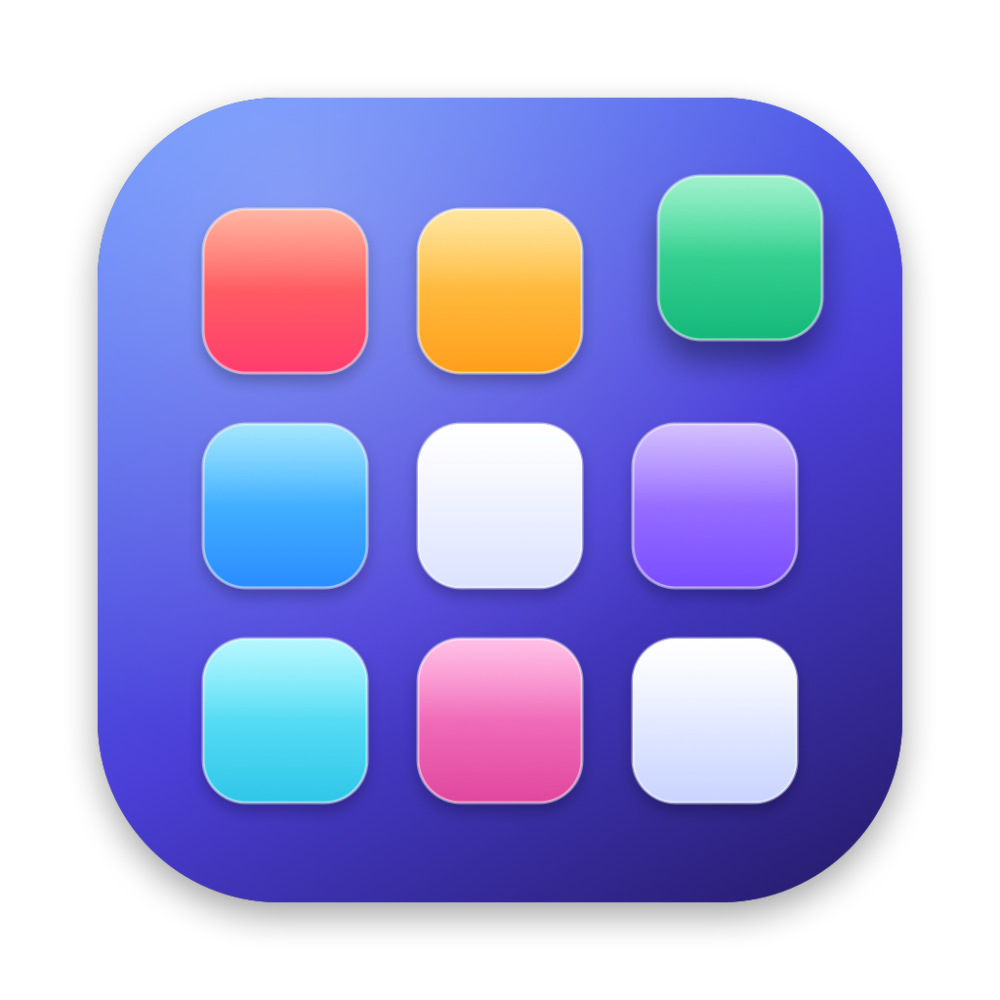

# LaunchApp

The classic Launchpad, back on macOS 26 and later. A native Swift app with Liquid Glass,
smooth 120 Hz animations, and all the extras in one free app.



## Install

Download `LaunchApp.dmg` from the [latest release](https://github.com/vuhpquang/launch-app/releases/latest),
open it and drag LaunchApp into Applications.

LaunchApp is signed with a self-signed certificate, not notarized. On first launch, if macOS
blocks it, open **System Settings → Privacy & Security** and click **Open Anyway**.

## Features

**Launchpad, as you remember it**
- Full-screen grid over your blurred wallpaper, page dots, swipe between pages with the
  trackpad, mouse wheel, a click-and-drag, or ⌘← / ⌘→.
- Folders: drag an app onto another to make one (named from the App Store category), click
  the name to rename it, drag apps out to take them back.
- Rearrange by dragging; hold at a screen edge to move to the next page (or make a new one).
- Type to search (accent-insensitive, initials like "vsc" work), arrow keys + ↩ to open.
- Edit mode: long-press an icon or hold ⌥ — icons jiggle and show uninstall badges.
- **Imports your old Launchpad layout** (pages and folders) on first launch.
- New apps appear by themselves; deleted ones disappear.

**Extras**
- Open it from the Dock icon, a global shortcut (default ⌥⌘L), the Launchpad/F4 key,
  a thumb-and-three-finger pinch, or a hot corner.
- Right-click menus: Open, Show in Finder, Rename, Hide, Add to / Remove from Dock,
  Remove from Folder, Uninstall.
- Drag an app onto the Dock to keep it there.
- Uninstall completely: moves the app and its leftovers in `~/Library` to the Trash.
- ⌘-click to select several apps: open, group into a folder, hide or uninstall them at once.
- Rename apps, hide apps, add your own app folders.
- Grid size, icon size, names, page dots, background (blurred wallpaper, Liquid Glass, dark),
  dimming, animation speed.
- Vertical scroll view instead of pages.
- Window mode: a centred panel instead of full screen.
- The Dock icon's menu lists every app and folder.
- Updates itself from GitHub releases.

## Keyboard

| Key | Action |
|-----|--------|
| type | search |
| ← → ↑ ↓, ⇥ | move the highlight |
| ↩ | open the highlighted app |
| ⌘← / ⌘→ | previous / next page |
| ⌘A | select everything on the page |
| ⌘F | focus search |
| ⌘, | settings |
| ⎋ | close folder → clear search → leave edit mode → close |

## Build

```bash
swift build && swift test
./build.sh                         # universal, signed .app + DMG in build/
scripts/release.sh X.Y.Z notes.md  # full GitHub release (see CLAUDE.md)
```

Requires macOS 26 and Xcode 26+.
